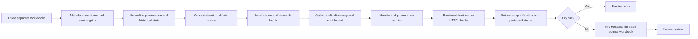

# Architecture

Research-only V1 now reads three separate Google workbooks: AUSTRALIA,
MANILA_LEGACY and MANILA_AUDIT_QUEUE. Each has its own Arc Research output tab.
Source sheets and formatting are never modified. The dataset registry preserves
existing organization and carries country, timezone, status and compliance policy.

## Adapters and ownership

Google Sheets spreadsheets.get provides effectiveFormat and theme colours through
the same Google Sheets OAuth used for values. Native HTTP nodes call the Google API
because the standard value-read operation lacks formatting. Batch updates write only
userEnteredValue in Arc Research. A versioned schema migration can insert machine
columns ahead of reviewer controls in that output tab, preserving existing cells.
They never use a source sheet ID or format mask.
Official references: [get](https://developers.google.com/workspace/sheets/api/reference/rest/v4/spreadsheets/get),
[CellData](https://developers.google.com/workspace/sheets/api/reference/rest/v4/spreadsheets/cells),
[API usage limits](https://developers.google.com/workspace/sheets/api/limits).

Google APIs impose quotas but no additional API usage charge. No paid formatting
service or enrichment API is added. OAuth needs edit access for output creation.
Read-only local openpyxl inspection produced ignored private snapshots and verified
source XLSX hashes before/after. The running workflow consumes Google Sheets, not XLSX.

Source and historical text are data, never instructions. Arc Research contains a
machine column prefix followed by operator-owned review controls. Upserts preserve
controls. Legacy state and original source references survive reruns. Details and
exact tab mappings are in data-schema.md.
The owner's 2026-10-04 confirmation locks all 55 Manila Legacy leads against another
initial touch, without needing colour coding or inventing missing history.

## Evidence and qualification

The opt-in `AUTONOMOUS_V2` extension replaces the manual official-source policy
below for eligible unresolved leads. It performs actual bounded Exa discovery,
automatic scored identity resolution, public-page enrichment and evidence-based
qualification. See [Autonomous research](autonomous-research.md). Existing Phase
1.5 mode remains available with its original bounds and reviewed-source policy.

The [verified email-domain inspection](email-domain-inspection.md) extension adds
bounded first-party destination observations to AUTONOMOUS_V2. Strong current
business association gates gap promotion; existing provider budgets, write
protections, batch continuation and Phase 2 boundaries remain in place.

Phase 1.5 is an opt-in layer inside the existing sequential worker. Its native
HTTP boundary calls the anonymous public Exa MCP endpoint; Code nodes never
perform network calls. Search matches remain candidates. Public fetches require
exact reviewed hosts, and contact promotion additionally requires a reviewed
official host/profile plus a business-name and address/phone match. New facts
pass through discovery-verifier.js before the existing qualification model.
Discovery facts and contact-platform URLs live in existing machine-owned
evidence_json; no reviewer-column or source-sheet migration is needed.
See [Phase 1.5 validation](phase-1.5-discovery-validation.md) for limits, provider
approval and the completed, bounded 25-lead test. Discovery stays optional and off;
it is not a prerequisite for Phase 2 and will not run on the remaining 254 leads.

Website responses establish technical observations, not active businesses or ownership.
Qualification 2.1 separates commercial_quality, contactability, research_confidence,
outreach_readiness and compliance_status. Verified activity, legitimacy, unresolved
gap and business case establish commercial merit independently of contact or consent.
MEDIUM can also describe provisional commercial potential supported by operations;
commercial_basis explicitly identifies cases whose gap is not yet established.
People and triggers are optional score/confidence bonuses. A commercially HIGH lead
can have weak contactability and PARK readiness. Australian consent review remains
separate. READY_FOR_REVIEW, SAFE_TO_REVIEW and READY_EMAIL never authorize sending.

Facts need source, timestamp and a bounded excerpt. Manual facts require verified
flag, dated evidence within 90 days, and public source URL. Activity can use evidence
within six months, or within twelve months with corroboration; signal type and age
weight confidence. HTTP success, directories or registration alone never prove trading.
research_required records critical identity/activity/legitimacy/gap/business-case
uncertainty, excluding consent, route delivery, optional enrichment and history locks.
Re-score mode uses stored observations without HTTP and preserves evidence timestamps,
history and arc_status. qualification_checked_at records only the new assessment.
V1 checks supplied website
candidates; it does not independently discover all missing contacts or evaluate nuanced
commercial gaps. Missing evidence is queued, not fabricated. An HTTP failure is not
proof the business closed. A search result alone never proves site association.

## Runtime and network boundary

Canonical JavaScript modules use Node built-ins only. build-workflows.js recursively
bundles pure logic plus crypto into n8n Code nodes. Native HTTP performs requests;
there is no arbitrary filesystem/network access in Cloud Code nodes. No packages,
LLM, browser service or paid API are required. Local mock tests do not prove Cloud
item-linking, OAuth or live error payload behavior.

URLs need an explicit exact reviewed host allowlist. Never derive it automatically
from untrusted source cells. Include legitimate www/redirect hosts individually.
IP literals, credentials in URLs, local/private hostnames and unusual ports are
rejected. Redirects are checked manually, TLS verification stays on. At most six GETs
per lead, one-second pacing, 15-second request timeout. No login, challenge bypass,
forms, Google HTML scraping, calls, automated DMs or email sending.

Cloud Code cannot inspect/pin DNS. A host allowlist is not full SSRF protection;
confirm deployment egress controls before scaling third-party URLs. Body analysis
is bounded after download, not at the network boundary. Optional local safe-http.js
pins public IPv4 DNS, caps streaming bytes and enforces wall-clock timeout; it is not
used secretly by the Cloud workflow. IPv6-only hosts require local-adapter review.

## Reruns, failures and retention

The [research integrity policy](research-integrity.md) governs append-only
observation history, non-destructive retry merges, current-versus-stale evidence,
targeted retries and read-only held-card diagnostics. It also separates actual
research blockers from NEEDS_COPY composer failures without changing outreach
authorization or protected history.

All datasets are normalized before duplicate review and batch selection. Identity
uses dataset/tab/original ID, not mutable row position. Header/schema mismatches,
duplicate output IDs and incorrect provenance stop writes. Existing protected states
win over research unless deliberately reset. Prior-contact and duplicate locks remain.

Single execution at a time, no sheet editing while it runs. Writes are keyed upserts
within each output tab, not atomic across workbooks. No write retries. Inspect an
ambiguous timeout before rerunning. This Cloud account caps executions at 180 seconds;
one lead per dataset is the default. Slow checks may require smaller reviewed test
inputs. Error draft stays unlinked/inactive; manual failures are inspected in n8n.

Successful/manual executions are configured not to persist; failed execution data
can include source contact information or raw responses. Restrict access and apply
short retention. No real data, secrets or execution exports belong in Git.

## Phase 2 MVP boundary

The local [operator lifecycle extension](operator-lifecycle.md) adds manual
observations, independently saved working copy, derived eligibility, exact-copy
approval, an explicit manual Zoho handoff request, reply/follow-up controls and
append-only audit history inside the existing Review Queue payload. No column or
source-workbook migration is required. Its local exports have not been published;
the five Phase 2 engines remain inactive/manual. The existing live panel still
uses its previously published version until the owner approves deployment.

The [draft eligibility boundary](phase-2-draft-eligibility.md) separates evidence
needed to create grounded copy from the stricter checks needed for approval and
handoff. Send-blocked drafts remain editable; source, history and sending protections
remain authoritative.

The [Outreach Review Panel](phase-2-panel.md) adds lead cards, filters, decision
buttons, a compliance dropdown and explicit messaging/send checkboxes over the
existing Inbox logic. Only its separate Cloud workflow is published, with the
owner's explicit authorization and Basic Auth on both webhooks. The unchanged
Inbox refresh logic is embedded in the panel so its standalone workflow can stay
inactive. Decision validation uses copies only. The canonical ledger and frozen
engines remain authoritative; existing outreach workflows remain manual and inactive.

The [Outreach Inbox](phase-2-inbox.md) is the operator projection/control layer
over the existing Cloud Review Queue. The queue remains canonical. A separate
private link table keeps stable Inbox row associations and snapshots; exact
payload matching guards review writes. Existing research, approval, provider,
suppression and recorded-send gates remain authoritative.

The production Cloud extension is documented in [Phase 2 Cloud Draft Queue](phase-2-cloud.md).
It consumes Arc Research read-only and uses separate n8n Data Tables for routine
review, approval, provider claims and recorded manual sends. The local MVP and its
frozen renderer/transport remain preserved. Production Phase 2 sample allowlists
are removed: manual Draft Queue cap 25, manual Review cap ALL, and at most one
approved unsent Zoho email draft per manual handoff. All workflows remain inactive;
the production UX patch does not execute Phase 1 or automate sending. The Inbox's
market column maps AUSTRALIA to Australia and MANILA datasets to Manila.

Phase 2 consumes existing Arc Research without changing Phase 1. A separate inactive
ten-row n8n validation workflow produces evidence/history-gated draft previews. A local
SQLite review queue owns approval, suppression, manual-send history and daily due
follow-ups. Social tasks stay manual. Composio Zoho CREATE DRAFT uses a separate
inactive native HTTP transport with the existing Composio API credential. A local
transactional claim and exact-content approval precede each controlled manual run.
Provider draft success records ZOHO_DRAFT_CREATED, never SENT or a follow-up date.
No send function exists. See [Phase 2 MVP](phase-2-mvp.md). Future automated sending still requires
provider idempotency and ambiguous-delivery reconciliation; neither Sheets upserts
nor this manual queue claims exactly-once delivery.

The operational extension adds idempotent MARK_SENT, daily follow-up controls and
a complete-universe routing report without changing the transport. Source snapshots
and routing are read-only; existing approvals and provider state stay in the local
ledger. See [Phase 2 operational loop](phase-2-operational-loop.md).

The [Phase 2 grounded copy boundary](phase-2-copy-quality.md) converts existing
verified evidence into controlled claims before zero-cost structured drafting. It rejects
raw research leakage and missing messages before actionable projection, approval
or Zoho handoff. Safe replacement preserves record identity and protected history.
This boundary changes no Phase 1 research or qualification logic.
